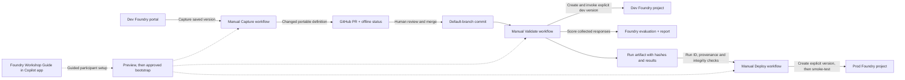

# Foundry agent delivery lab

This lab provides an on-demand release path for a prompt agent managed in the
Microsoft Foundry portal. It is separate from the introductory samples in
`02-microsoft-foundry-agents/`.

## What exists and what this lab adds

The introductory labs contain Foundry quickstarts. This folder adds the
reusable release workflows, participant bootstrap, evaluation assets, and
workshop-specific Azure infrastructure for the delivery exercise. Instructors
provide existing, isolated
dev and prod Foundry projects and approved model deployments for each
participant; the lab does not create Foundry accounts, projects, model
deployments, resource groups, or paid services.

Each participant uses a repository copy and a separate dev/prod identity pair.
Do not reuse the example configuration from another participant or the
`FoundryTest` experiment. It contains no live Azure identifiers.

## Architecture



The Copilot custom agent is the **workshop guide**, not the Foundry agent being
promoted. It guides setup and each stage. The participant runs one interactive
bootstrap command that collects a subscription ID and project endpoints,
discovers resource groups, deployments, agents, and model policy, and previews the Azure changes. Azure access is applied only after the
participant reviews the plan and enters its exact hash.

## Delivery stages

1. **Capture development agent** — Manually capture the latest saved,
   non-draft dev version. The workflow removes environment-bound model details,
   validates the remaining portable prompt-agent definition, runs offline
   checks, and opens a PR only if the canonical definition changed. It runs
   checks before creating the PR and publishes a status on the captured commit;
   it does not rely on a `GITHUB_TOKEN`-created PR triggering another workflow.
2. **Validate reviewed agent** — Manually run from the default branch. The
   workflow checks the definition, dataset, policy and offline integrity,
   creates a new dev test-agent version from Git, invokes that explicit version,
   performs deterministic smoke assertions, and submits those exact responses
   to Foundry cloud evaluation. The LLM rubric is advisory; missing/failed
   execution, incomplete evidence, hash/version mismatches, and deterministic
   failures block deployment.
3. **Deploy verified agent** — Manually provide the successful validation run
   ID. The workflow verifies repository, workflow, default branch, commit,
   event, attempt and evidence before requesting prod access. It creates and
   records a new explicit prod version before smoke testing. It never changes
   application routing or points clients at `latest`.

## Template and instructor preparation

1. This source repository is configured as a GitHub template. Participants use
   **Use this template** to create their own copy; do not ask them to fork a
   shared lab instance. When publishing a different source repository, its
   owner must enable **Settings -> General -> Template repository**.
2. Provide each participant an existing dev/prod account and project pair,
   isolated from other participants. Confirm each account's region, approved
   model deployment, model version, deployment type, upgrade policy, and
   available quota. Bootstrap discovers and reports the live policy for
   comparison; it never selects or changes a model.
3. Confirm the participant's GitHub plan and repository visibility. This lab
   does not assume protected environments or required reviewers are available.
   The `production` environment separates the prod OIDC subject, but is **not**
   an approval gate unless a repository administrator explicitly configures
   protection. Restrict who can run Actions/Deploy under the repository's
   available governance; evidence validation is not independent approval. Use
   native automatic Copilot review when available; otherwise document the
   manual **Reviewers -> Copilot** request for PRs.
4. In each template-created repository, enable GitHub Actions and enable
   **Allow GitHub Actions to create and approve pull requests** so Capture can
   push its branch and open a PR with `GITHUB_TOKEN`. The workflow does not
   approve or merge PRs; do not add a PAT.
5. Verify OIDC in a GitHub Actions run before the workshop. Workflows decode
   the issued token's `sub` claim and compare it with the exact bootstrapped
   subject before Azure login. A mismatch fails closed. Do not replace the
   subject with a wildcard.
6. The **Check workshop setup** workflow runs the offline tests and compiles
   the OIDC Bicep template on PRs that change `infra/`, `scripts/`, or
   `tests/`. Keep it green before publishing template changes.

### Participant one-time setup

```bash
az login
gh auth login
cd 04-foundry-agent-delivery
python scripts/bootstrap.py --setup
```

Setup first checks prerequisites (Python, `az`/`gh` sign-in, a working Bicep
CLI, repository admin access) and prints the fix for anything missing. It then
asks only for:

1. The **subscription ID**. It is checked directly; subscriptions are never
   listed or searched, so large tenants are not a problem.
2. The **dev and prod project endpoints**, for example
   `https://<account>.services.ai.azure.com/api/projects/<project>`. Account,
   project, and resource group are derived from the endpoint within that one
   subscription.
3. The **model deployment** and **agent** to promote, chosen from numbered
   lists read from the dev/prod accounts and the dev project. A single
   deployment is the default; an unlisted agent is rejected.
4. The **production reviewers** (defaults to your GitHub login, `none` skips).

A mistyped answer is re-asked instead of ending setup. Instructors can hand out
a single non-interactive command instead:

```bash
python scripts/bootstrap.py --setup \
  --subscription <subscription-id> \
  --dev-endpoint https://<dev-account>.services.ai.azure.com/api/projects/<dev-project> \
  --prod-endpoint https://<prod-account>.services.ai.azure.com/api/projects/<prod-project> \
  --model-deployment <deployment> --agent-name <agent> --production-reviewer <login>
```

Run `python scripts/bootstrap.py --help` for every option. The identity
resource group defaults to the dev resource group.

The config is saved to the ignored `participant.json`. Setup then prints the
discovered endpoint/model policies, the full Azure `what-if`, a short summary
of the real changes, and any warnings (for example, the agent has no saved
prompt version, or **Allow GitHub Actions to create and approve pull requests**
is off; that setting is only reported, never changed). When reviewers are
given, the plan also creates the `production` environment with those required
reviewers and a `main`-only branch policy, so Deploy waits for approval.
Reviewers are part of the plan hash. On reruns, `Modify` on existing role
assignments is expected because what-if cannot resolve principal IDs.

Enter the exact displayed SHA-256 only if you approve those changes. Setup
repeats discovery and `what-if`, and stops without applying if the plan
changed. It never changes the active Azure subscription.

Requires Python 3.12+, Azure CLI, and GitHub CLI; Azure CLI handles the Bicep
build. Authenticate only with local `az login` and `gh auth login`. The
participant needs repository admin access to set repository variables and
Azure permission to create identities, custom role definitions, federated
credentials, and scoped assignments. Bootstrap is not transactional; if a
later GitHub operation fails, inspect completed Azure changes before retrying.

## Participant quickstart

1. In the Foundry portal, edit and save the agent in the dev project. Do not
   include conversations or customer data in this repository.
2. In GitHub Actions, run **Capture development agent** from the default
   branch. Review its change log, captured commit status, and generated PR.
   Request Copilot review automatically where supported, or select
   **Reviewers -> Copilot** manually. Review and merge the PR using normal
   repository policy.
3. After the merge, run **Validate reviewed agent** from the default branch.
   Inspect the workflow summary, artifacts, explicit dev-agent version, and
   Foundry evaluation report before treating the advisory scores as useful.
4. Run **Deploy verified agent to production** from the unchanged default
   branch and provide the successful validation run ID. Inspect the recorded
   production version and smoke-test result. If the default branch changes
   after validation, validate again.

## Evaluation design and evidence

The small dataset focuses on format and instruction-following behavior that is
independent of any particular domain. Replace it with representative,
privacy-safe cases for the workshop agent, and update expected behaviors and
references in the same reviewed commit. Deterministic assertions are smoke
checks, not proof that a factual answer is correct. The rubric scores
instruction following, relevance, and clarity; it does not claim groundedness
and does not treat citations or keywords as factual evidence.

Validation invokes the explicit agent version once per case. Foundry cloud
evaluation scores the collected responses rather than generating another set
of responses. Evidence records the commit, canonical config/dataset/rubric
hashes, agent and version, evaluator name and returned version, judge model
deployment, evaluation and run IDs, report URL, response, score, and reason.
Partial evidence is retained when a request or run fails. Polling and retries
are bounded. A score is advisory until the instructor calibrates it; this lab
does not impose a numeric release threshold.

Each cloud run registers a content-addressed, run-unique evaluator identity,
confirms that the registered version is visible before submitting the run, and
rejects results whose evaluator version differs from the registered version.
Retries use a new identity rather than silently reusing a mutable name. This is
an integrity strategy, not a claim that evaluator registration is immediately
consistent: verify it with repeated live runs in the approved workshop project
before using it in a workshop. Evaluator registration can require Foundry
asset read/write in addition to evaluation read/write; asset write is broader
than evaluator-only access and is called out in the Bicep role.

The current Foundry service has region-specific evaluator support and quota
limits. Rubric evaluation is preview functionality and may change. Review the
current Microsoft documentation and the actual account's region, model support,
quota and service limits before running the live stage. Cloud evaluation
submits each response and its reviewed reference to the participant's dev
project; do not use sensitive data.

## Expected outputs

- Capture: `agent/config.json` change log in the Actions summary/artifact, a PR
  only for changed configuration, and an offline-validation commit status.
- Validate: a `validation-<run-id>-<attempt>` artifact containing incremental
  verification and cloud-evaluation evidence, plus a Foundry report link.
- Deploy: a `release-<run-id>-<attempt>` artifact mapping the reviewed commit
  to the explicit production version and smoke-test outcome.

## Cost and data retention

Bootstrap creates identities, federated credentials, custom role definitions,
and role assignments only; it does not create model deployments or other
billable Foundry services. Each Validate run invokes the dev agent once per
dataset case, then submits those collected responses to Foundry cloud
evaluation for the rubric judge and built-in Violence evaluator. Deploy adds
one prod smoke invocation. Cost depends on response/judge tokens, deployment
pricing, quota, region, and current evaluation-service pricing. Check the
participant's deployment and price sheet before the live run; re-running
validation repeats those calls.

Foundry evaluation persists its dataset and results in the dev project. The
GitHub artifact also contains response text, scores, and reasons and follows
the repository's Actions artifact-retention policy. Use privacy-safe cases;
never include customer data or secrets. Response API calls set `store: false`,
but that does not prevent evaluation or GitHub artifact retention.

## Troubleshooting and limitations

- **OIDC subject mismatch:** inspect the workflow's redacted subject diagnostic,
  compare it to the participant's GitHub-issued claim and configured federated
  credential, and rerun the read-only bootstrap preview. Never broaden trust
  with a wildcard.
- **403 from Foundry:** verify the dev/prod identity's scoped custom role,
  account-level inference permissions, model deployment, project endpoint,
  and whether evaluator registration requires `AIServices/assets/read` and
  `AIServices/assets/write`. Allow time for role propagation.
- **Unsupported agent setting or tool:** Capture fails explicitly. Extend the
  portability allowlist and environment binding code with offline tests before
  supporting that capability; do not silently discard the setting.
- **Evaluation version mismatch or missing output:** the result is blocking
  even when the run says completed. Keep the artifact and Foundry run ID for
  investigation; do not retry against a mutable evaluator name.
- **Quota, preview, or regional errors:** retain partial evidence, check current
  Foundry regional support and quota, and reduce run cadence only through an
  instructor-approved change.
- **`az bicep` fails on Apple silicon:** the installed Bicep binary is for the
  wrong CPU. Run `az bicep uninstall` and then
  `az bicep install --target-platform osx-arm64`.
- **`az` cannot see the subscription:** sign in to the workshop tenant with
  `az login --tenant <tenant-id>`; setup never searches other subscriptions.
- **No protected production environment:** require an independent human to
  control who can dispatch Deploy. The workflow's provenance checks are not
  independent release approval.

## Instructor demo script

1. Edit and save the agent in the dev Foundry portal.
2. Run Capture, inspect the diff and offline status, review and merge the PR.
3. Run Validate on the new default-branch commit.
4. Open the Foundry evaluation report and compare its run/version with the
   workflow evidence.
5. Run Deploy with the validation run ID; inspect the explicit prod version and
   smoke result. Do not switch application routing.

## Cleanup

Cleanup is intentionally separate and is not automated by this lab. After
instructor approval, identify the exact participant identities, federated
credentials, role assignments, and GitHub variables to remove. Do not delete
the participant's Foundry accounts, projects, deployments, repository, or
shared workshop resource groups as part of identity cleanup.

## Current official references

- [Cloud evaluation overview](https://learn.microsoft.com/azure/foundry/observability/how-to/cloud-evaluation)
- [Evaluate model and agent targets](https://learn.microsoft.com/azure/foundry/observability/how-to/cloud-evaluation-targets)
- [Evaluation permissions](https://learn.microsoft.com/azure/foundry/observability/how-to/evaluation-permissions)
- [Rubric evaluators](https://learn.microsoft.com/azure/foundry/concepts/evaluation-evaluators/rubric-evaluators)
- [Built-in evaluators](https://learn.microsoft.com/azure/foundry/concepts/built-in-evaluators)
- [Evaluation regions and limits](https://learn.microsoft.com/azure/foundry/concepts/evaluation-regions-limits-virtual-network)
- [GitHub OIDC in Azure](https://docs.github.com/actions/how-tos/secure-your-work/security-harden-deployments/oidc-in-azure)
- [GitHub OIDC subject claims](https://docs.github.com/actions/reference/security/oidc#immutable-subject-claims)
